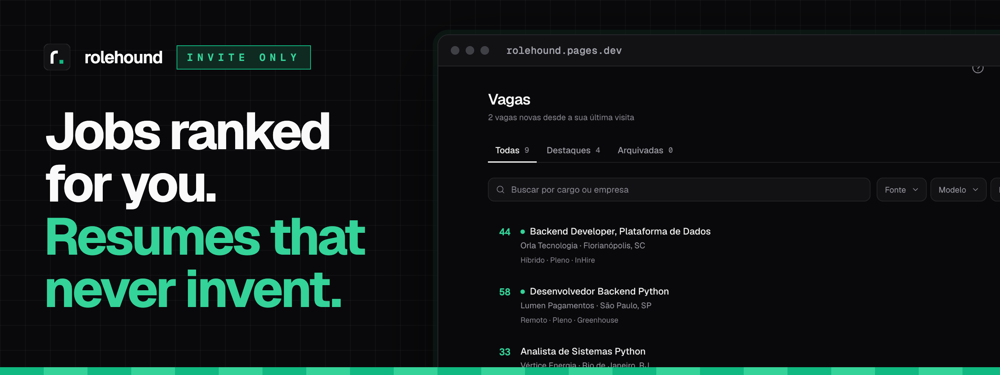
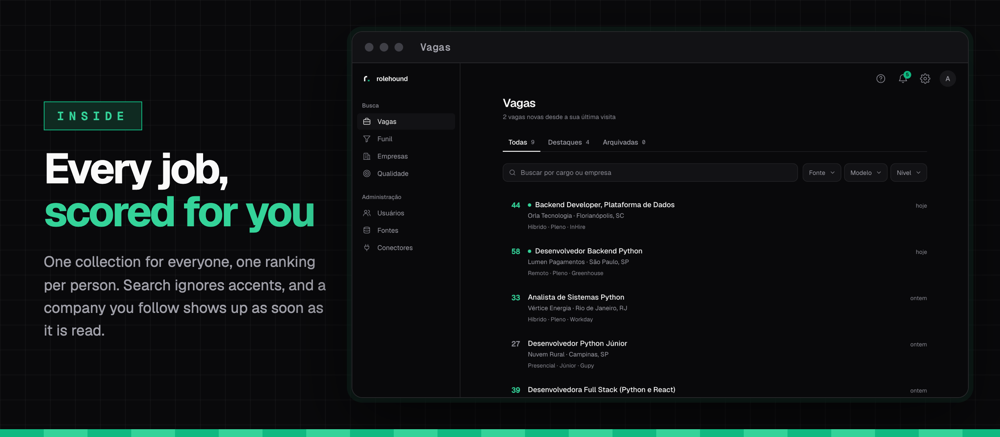
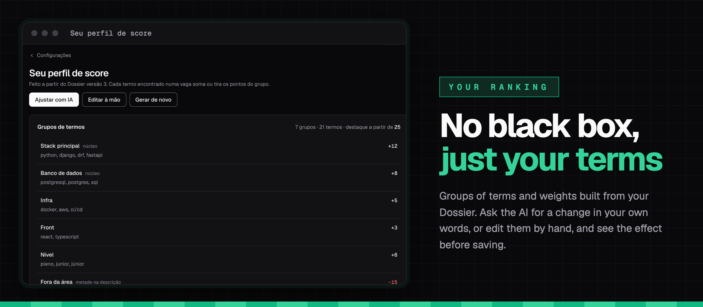
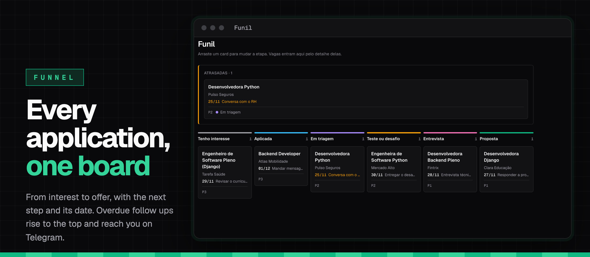
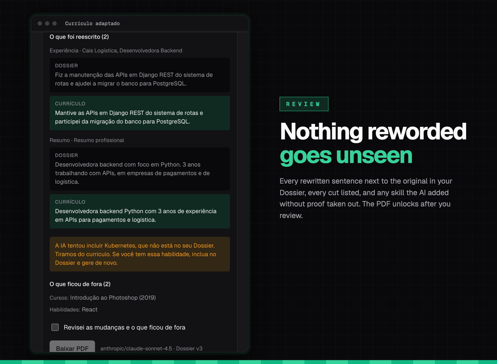

<p align="center">
  
</p>

<p align="center">
  A <b>private job hunting app</b> for the Brazilian market:<br>
  it collects postings, ranks them against <b>your</b> profile, tracks your applications,<br>
  and helps you apply with AI that <b>never invents facts</b>.
</p>

<p align="center">
  
  
  
  
  
</p>

## Why

Job boards show the same posting on five sites, rank by date instead of fit, and
an AI that writes your resume will happily add a job you never had. Rolehound
fixes the three problems for a small group of people: one collection for
everyone, one ranking per person, and AI output checked against the facts you
gave it.

## How it works


1. **The admin invites you.** There is no public sign-up. You get an email
   with a single use link to set your password.
2. **You bring your OpenRouter key.** Every AI call runs on your own key and
   the models you pick. The app tests the key and each model before saving.
3. **You import your Dossier.** One JSON file with your experience, education,
   skills and preferences. The app ships a prompt you run in any AI chat: it
   interviews you and writes the file. The app validates it and shows it to
   you before saving.
4. **The app builds your score profile.** From the Dossier, AI proposes the
   term groups, weights and search terms that rank jobs for you. You review
   and choose, then adjust it in your own words or edit it by hand.
5. **Jobs arrive ranked.** Collection runs at 9h, 12h, 15h and 18h (Brazil
   time) and every posting gets your score, with the best ones highlighted.

## Features



- **Collection:** connectors for **Gupy, InHire, Greenhouse, Lever, Workday**
  and job repositories on **GitHub**, plus any **careers site** that publishes
  its jobs for search engines (sitemap and schema.org JobPosting, robots.txt
  obeyed, public addresses only). A posting missing from a source's latest
  snapshot is archived and reopens if it comes back.
- **Follow companies:** paste a company's careers page, or one of its job
  links, and it becomes a source. Its jobs show up in your list as soon as
  the first read ends, and new ones that match you reach you by notification.
- **Paste a link:** add any posting by its URL. Sources with a connector are
  fetched through it; for the others you paste the text, and that job is
  yours alone. The app never scrapes sites it has no connector for.
- **Ranking per person:** weighted term groups, title hits count double,
  penalties for stacks you do not want and for experience above your level.
  Jobs are shared, scores are not. Search ignores accents and case.


- **Application funnel:** applications, interactions and follow ups on one
  board, from interest to offer, with overdue follow ups called out.



- **Pitch:** a "tell us about yourself" text for a posting, written only from
  your Dossier.
- **ATS analysis:** how your resume PDF reads against a posting.
- **Tailored resume:** the AI returns JSON, the code renders the PDF.
  Companies, titles, dates and education are copied from the Dossier, a skill
  the AI cites without it being there is taken out and pointed out, reworded
  bullets are shown side by side for review, and every cut is reported.
- **Accuracy:** label a sample of jobs and see how precise your highlights are,
  instead of judging the ranking by feel.
- **Notifications and Telegram:** new highlights, companies you follow,
  overdue follow ups and finished collections, in the app and, optionally,
  through a Telegram bot you connect with a link or a QR code.
- **Help center:** a public FAQ at `/ajuda`, reachable from the sign-in
  screens and from the app.



## Built to protect the people using it

- **Accounts:** ASP.NET Core Identity with HttpOnly, SameSite=Strict cookies,
  optional 2FA by authenticator app or email code, lockout after 5 failed
  attempts and rate limits. Changing the password or signing out everywhere
  voids every pending email link and disconnects Telegram.
- **Your key stays yours:** OpenRouter keys are encrypted at rest and never
  sent back to the browser. No shared key, no fallback.
- **Your data:** export everything the app keeps about you as JSON, or delete
  your account for good. Each AI feature sends only the parts of the Dossier
  it needs.
- **Free models, knowingly:** the model picker warns that free models may use
  prompts for training and shows the typical cost of paid ones per use.
- **Untrusted job text:** job descriptions reach the model inside delimiters
  it cannot close, every answer must follow a JSON schema, and the resume
  check verifies the facts in code instead of trusting the model.
- **Sites people add are read safely:** only public internet addresses,
  bounded size and time per page and per source, and robots.txt obeyed.

## Running locally

Requires the .NET 10 SDK, Node.js 26 and PostgreSQL (Docker or a local install).

```bash
docker compose up -d        # PostgreSQL on 5432 and Mailpit on http://localhost:8025
```

Without Docker, create the role and databases on a local PostgreSQL:

```bash
psql -d postgres -c "CREATE ROLE rolehound LOGIN PASSWORD 'rolehound' CREATEDB"
createdb -O rolehound rolehound && createdb -O rolehound rolehound_test
```

Then:

```bash
cd backend && dotnet run --project src/Rolehound.Api   # API on http://localhost:5080, migrates on start
cd frontend && npm ci && npm run dev                   # web app on http://localhost:5173
```

In development the first admin comes from `Admin:Email` and `Admin:Username`
(see `appsettings.Development.json`, or override with `dotnet user-secrets`).
Without an SMTP server, emails (with their links) are written to the API log.

## Tests

```bash
cd backend && dotnet format --verify-no-changes && dotnet test   # API tests need the rolehound_test database
cd frontend && npm run lint && npm run build
```

GitHub Actions runs both on every push. The API suite uses a fake OpenRouter,
so it spends no credits and needs no network.

Parity tests against the previous tool need a dataset that is not part of
this repository; see `backend/tools/parity/export_previous_tool.py`. Without
it they are skipped.

## Deploy

One Google Cloud e2-micro VM runs the API, PostgreSQL, Caddy (HTTPS), the task
scheduler and daily backups with Docker Compose. The web app runs on
Cloudflare Pages, and a Pages Function forwards `/api` to the VM, so no
custom domain is needed. CI builds the API image and pushes it to the GitHub
Container Registry, so the VM never compiles .NET; it runs the exact commit
set in `API_TAG`. Step by step guide in
[`deploy/README.md`](deploy/README.md).

<details>
<summary><b>Repository layout</b></summary>

```text
backend/                      .NET 10
  Rolehound.slnx              solution
  src/Rolehound.Api/          ASP.NET Core host (Minimal APIs)
    Features/                 one folder per module, one subfolder per use case
    Infrastructure/           persistence, HTTP defaults, email, security
  src/Rolehound.Connectors/   job sources (Gupy, InHire, Greenhouse, Lever, Workday, GitHub, careers sites)
  src/Rolehound.Scoring/      pure scoring rules, no I/O
  Dockerfile                  production image of the API (built by CI)
  tests/                      one test project per source project
  tools/parity/               exports the parity dataset from the previous tool
frontend/                     React + TypeScript (Vite)
  src/app/                    providers and routes
  src/features/               one folder per module, mirroring the API
  src/lib/                    shared client code (HTTP)
  src/styles/                 design tokens and base styles
deploy/                       production: compose, Caddy, scheduler, backups
compose.yaml                  local PostgreSQL and Mailpit
```

</details>

## Stack

| Layer | Technologies |
|---|---|
| **Backend** | .NET 10, ASP.NET Core Minimal APIs, EF Core, ASP.NET Core Identity, QuestPDF, PdfPig, MailKit, xUnit v3 |
| **Frontend** | React 19, TypeScript, Vite, React Router, TanStack Query, CSS Modules, oxlint |
| **Database** | PostgreSQL 18 |
| **AI** | OpenRouter, with each person's own key |
| **Infra** | Google Cloud, Cloudflare Pages, Caddy, Docker Compose, GitHub Actions |

## Author

**[Mauro Junior](https://github.com/mj01px)**
